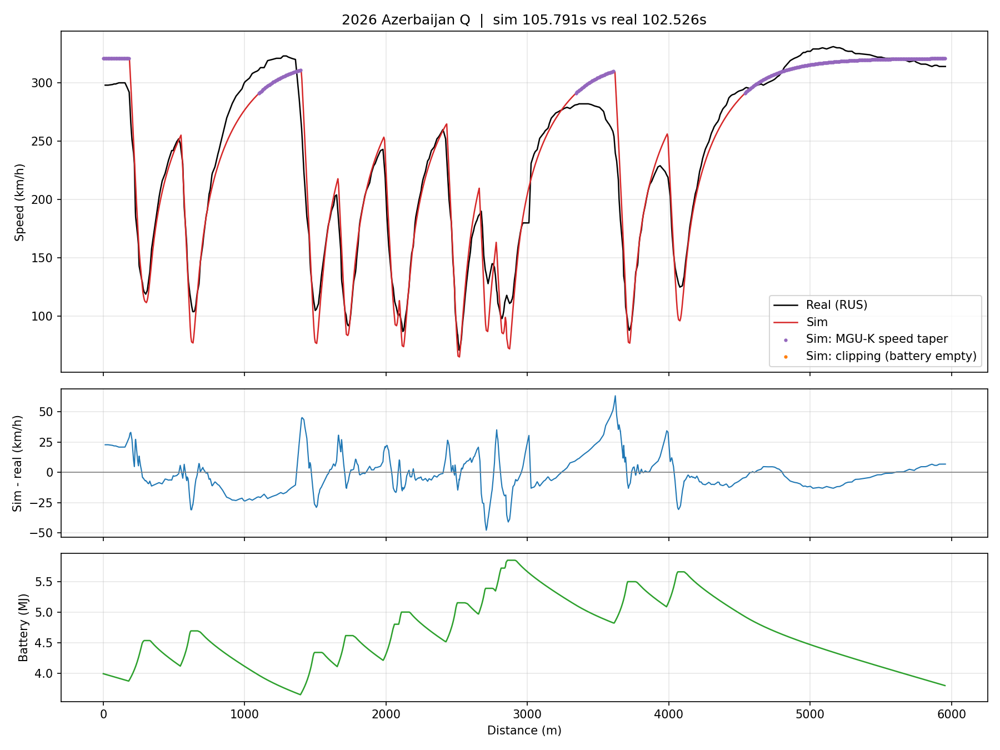

# Baku LapSim

A quasi-steady-state lap time simulator for 2026-regulation Formula 1 cars, built after the 2026 Azerbaijan Grand Prix and correlated against George Russell's qualifying lap (1:42.526) using public FastF1 telemetry.

The simulator is the starting point. The main work is **correlation**: using the gap between simulation and real telemetry to find what the model gets wrong, fixing it, and testing every fix on synthetic data before trusting it on the real lap.



## Results

- Speed RMSE on the clean lap: 23.7 km/h baseline, 14.2 km/h calibrated
- Low-speed traction phase RMSE: 14.3 km/h baseline, 6.8 km/h calibrated
- High-speed acceleration phase RMSE: 21.9 km/h baseline, 10.9 km/h calibrated

"Clean lap" excludes five stretches (15.7% of the lap) where GPS-derived geometry is physically implausible; see below.

## Main finding: 2026 energy management is visible in public data

On several straights the real car accelerates, then holds flat or slows while still at full throttle: about 280 km/h from 3,200 to 3,600 m, and on the final straight a peak of 331 km/h falling to about 315 km/h. That pattern is consistent with 2026 deploy-then-derate energy management, where electrical deployment is front-loaded and then cut. A constant-power, deploy-until-empty energy model cannot reproduce it, and this is the largest remaining source of error. Teams do not publish deployment strategies, so this is an interpretation of public telemetry, not a confirmed team strategy.

## How the model was correlated

Each real-data run was diagnosed by splitting speed error by driving phase (braking, low-speed traction, high-speed acceleration). Each fix was validated on synthetic telemetry with known parameters before re-running on the real lap.

1. **Track geometry.** Single-lap GPS is sparse (about 4 Hz) and noisy. Geometry is rebuilt from GPS pooled across 80 qualifying laps, map-matched, smoothed, with curvature removed where the driver is flat out and capped by the lateral g the real car could have pulled.
2. **Data quality.** Five stretches, including the castle section, implied over 3.6 g at low speed in every reconstruction method, consistent with GPS multipath between buildings. They are flagged and excluded from the fit rather than tuned to match.
3. **Traction.** The first model limited acceleration by all four tyres' grip. F1 cars are rear-wheel drive; limiting traction to the driven axle halved the low-speed traction error.
4. **Power and drag.** The sim reached top speed too early: too much power hidden by too much drag. Effective electrical deployment power is now fitted.
5. **A ruled-out hypothesis.** A separate braking limit was tested as a fitted parameter; the data drove it to an implausible bound, so it was held fixed at 5 g instead.

## Method

- **Model:** point-mass quasi-steady-state lap simulation (backward braking pass, forward acceleration pass) with friction-circle grip, downforce and drag, active aero corner and straight modes, ICE plus MGU-K power with speed taper, battery state of charge and braking harvest.
- **Calibration:** Nelder-Mead fit of grip, drag (both aero modes), harvest limit and deployment power, minimising speed RMSE, clean-lap time error and corner apex error. Parameters that hit their bounds are flagged as compensating or not identifiable.
- **Outputs:** corner-by-corner minimum speeds, error by driving phase, an alignment check, and a lap-time sensitivity table.

## Run it

```
pip install -r requirements.txt
python run_baku.py --offline      # self-test on a synthetic track, no internet
python run_baku.py                # 2026 Azerbaijan qualifying, fastest lap
python run_baku.py --driver LEC   # another driver
python run_baku.py --geometry-sweep
python tests/geometry_test.py     # validates the GPS geometry pipeline
```

The first real run downloads session data into `f1_cache/` (a few minutes). Plots and fitted parameters are written to `outputs/`.

## Limitations

- Point-mass model: no load transfer, tyre temperature or driver behaviour.
- Fitted values are effective parameters that make this model match public data, not the cars' true figures. Downforce and the braking limit are held at priors because Baku's mostly slow corners cannot separate them from grip. Fitted deployment power and harvest limit reach their bounds and should not be quoted as real values.
- Regulation-derived energy values are approximations of the 2026 FIA Technical Regulations.
- GPS geometry errors are handled by exclusion; about 16% of the lap is not used in the fit.

## Next

Train a model on the calibrated simulator's residuals to learn the deploy-then-derate energy pattern, and a surrogate model for fast setup sensitivity studies.

## Data

Session data comes from the [FastF1](https://github.com/theOehrly/Fast-F1) library and is not included in this repository. This project is unofficial and not associated with Formula 1 or any team.

## Author

Kazi Sadia Anowar, B.S. Computer Science and Artificial Intelligence, New York Institute of Technology. [LinkedIn](https://linkedin.com/in/asadia)
